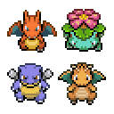
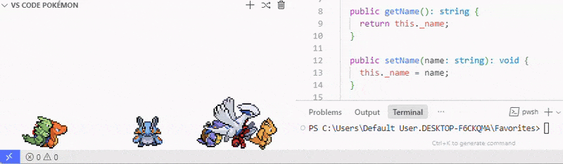
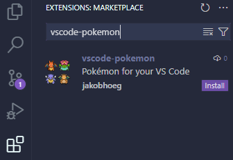
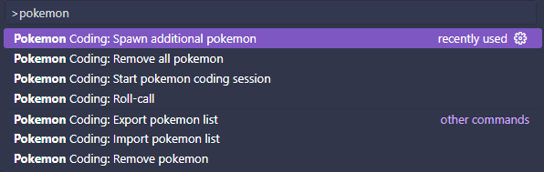
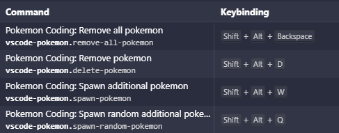

<div align='center'>

# VS Code Pokémon


</div>

<p align="center">
    Puts cute Pokémon in your code editor to boost productivity ✨
    <br>
    <br>
    <a href="https://github.com/jakobhoeg/vscode-pokemon/issues/new?assignees=&labels=feature&template=bug_report.md&title=">Report a Bug</a>
    ·
    <a href="https://github.com/jakobhoeg/vscode-pokemon/issues/new?assignees=&labels=feature&template=feature_request.md&title=">Request feature</a>
</p>

<div align="center">


</div>

<div align="center">
<picture>
  <source media="(prefers-color-scheme: dark)" srcset="https://github.com/jakobhoeg/vscode-pokemon/raw/main/vscode-pokemon.gif">
  <source media="(prefers-color-scheme: light)" srcset="https://github.com/jakobhoeg/vscode-pokemon/raw/main/vscode-pokemon-light.gif">
  
</picture>
</div>

<div align="center">

Seen used by engineers at [Microsoft](https://code.visualstudio.com/updates/v1_101#_chat-ux-improvements)!

</div>

## Installation

Install this extension from the [VS Code marketplace](https://marketplace.visualstudio.com/items?itemName=jakobhoeg.vscode-pokemon) or the [Open VSX Registry](https://open-vsx.org/extension/jakobhoeg/vscode-pokemon).



OR

With VS Code open, search for `vscode-pokemon` in the extension panel (`Ctrl+Shift+X` on Windows/Linux or `Cmd(⌘)+Shift+X` on MacOS) and click install.

OR

With VS Code open, launch VS Code Quick Open (`Ctrl+P` on Windows/Linux or `Cmd(⌘)+P` on MacOS), paste the following command, and press enter.

`ext install jakobhoeg.vscode-pokemon`

## Using VS Code Pokémon

After installing, open the command palette with `Ctrl+Shift+P` on Windows/Linux or `Cmd(⌘)+Shift+P` on MacOS.

Run the "Start Pokemon coding session" command (`vscode-pokemon.start`) to see a Bulbasaur in VS Code:



Enjoy interacting with your favourite Pokémon!

## Feeding, growing and evolving

Your Pokémon get hungry over time: a hungry Pokémon shows a fork-and-knife bubble every now and then. To feed one, do any of the following:

- Click the berry icon in the title bar of the VS Code Pokémon view
- Run **`Pokemon Coding: Feed pokemon`** from the command palette
- Double-click the Pokémon

Each meal gives 1 XP and makes the Pokémon a little bigger, but never bigger than the view. After eating, a Pokémon stays full for a while before it can be fed again. Once it has eaten enough, it evolves into its next form. Pokémon with several possible evolutions, like Eevee, pick one at random. XP is saved between sessions, synced with Settings Sync, and included when you export your Pokémon list.

| Setting | Default | Description |
| --- | --- | --- |
| `vscode-pokemon.feedCooldownMinutes` | `30` | Minutes a Pokémon stays full after eating. `0` turns the cooldown off. |
| `vscode-pokemon.feedsToEvolve` | `5` | Meals needed to evolve into the next form. |

A Pokémon gets hungry 2 hours after its last meal, or when its cooldown ends if that's longer. A few Pokémon can't evolve yet because the extension doesn't have sprites for their next form.

## Keyboard Shortcuts

VS Code Pokémon comes with default keyboard shortcuts to make managing your Pokémon quick and easy:



### Configuring Keyboard Shortcuts

You can customize these shortcuts to match your preferences:

1. Open the command palette (`Ctrl+Shift+P` on Windows/Linux or `Cmd(⌘)+Shift+P` on MacOS)
2. Run the **`Pokemon Coding: Configure keybindings`** command
3. Select the command you want to customize
4. VS Code will open the Keyboard Shortcuts editor filtered to that command
5. Click the pencil icon next to the command and press your desired key combination

## Changing settings

Open the setting panel with Ctrl+, on Windows/Linux or Cmd(⌘)+, on MacOS. In the search bar, enter “vscode-pokemon" to see all available options.

Set the size and position of the extension.

### Default Pokémon

You can configure specific Pokémon to automatically appear when you first start using the extension. This is useful for setting up your preferred team without having to manually spawn them when you open new windows.

To configure default Pokémon, add the following to your `settings.json`:

```json
{
  "vscode-pokemon.defaultPokemon": [
    {
      "type": "pikachu",
      "name": "Sparky"
    },
    {
      "type": "charizard",
      "name": "Flame"
    },
    {
      "type": "articuno"
    },
    {
      "type": "mewtwo",
      "shiny": true
    },
    {
      "type": "random"
    },
    {
      "type": "random",
      "pool": ["pikachu", "eevee", "gengar", "snorlax"]
    }
  ]
}
```

- **`type`** (required): The Pokémon species (e.g., `"pikachu"`, `"charizard"`, `"mewtwo"`), or `"random"` to spawn a random species
- **`name`** (optional): A custom name for your Pokémon. If not provided, a random name will be assigned
- **`shiny`** (optional): Determines if the Pokémon is shiny, if not set will use `vscode-pokemon.shinyOdds` setting.
- **`pool`** (optional): Only used when `type` is `"random"`. Restricts the random selection to this list of species. Invalid entries are dropped with a warning; if none are valid, selection falls back to any Pokémon.

**Note:** The extension automatically saves your current Pokémon between sessions. The `defaultPokemon` setting is only used when:
- You start the extension for the first time
- You open a new windows/repository
- You have removed all Pokémon (no saved session exists)

A `"random"` entry is resolved to a specific species the first time it's applied, then saved like any other Pokémon — reopening the window won't re-roll it, only removing all Pokémon will.

To reset to your default Pokémon, use the "Remove all pokemon" command and restart VS Code.

### Pokémon Language

You can customize the language used for Pokémon names. The extension supports official Pokémon languages: English (US), French, German, and Japanese.

#### Using the Command

1. Open the command palette (`Ctrl+Shift+P` on Windows/Linux or `Cmd(⌘)+Shift+P` on MacOS)
2. Run the **`Pokemon Coding: Change Pokemon language`** command
3. Select your preferred language from the list

#### Using Settings

You can also configure the language directly in your `settings.json`:

```json
{
  "vscode-pokemon.pokemonLanguage": "fr-FR"
}
```

Available options:
- **`auto`** (default): Automatically uses VS Code's language setting
- **`en-US`**: English (US) names
- **`fr-FR`**: French names (e.g., "Bulbizarre", "Salamèche", "Dracaufeu")
- **`de-DE`**: German names (e.g., "Bisasam", "Glumanda", "Glurak")
- **`ja-JP`**: Japanese names (e.g., "フシギダネ", "ヒトカゲ", "リザードン")

**Note:** The language setting applies to all Pokémon names throughout the extension, including in the spawn selection menu, roll-call, and export features. Translations are available for all Pokémon from Generations 1, 2, 3, and 4.

## Features

Extracting and creating .gif files involves quite a bit of tedious manual work, but I’ll aim to add Gen 5 when possible.

## Credits

### Sprite Sources
- Pokemon Sprites: © The Pokémon Company / Nintendo / Game Freak
- The sprites are used for non-commercial, fan project purposes only
- Original sprite artwork belongs to the respective copyright holders

### Acknowledgments
- All sprites are property of their original creators
- This repository is a fan project and is not affiliated with Nintendo, The Pokémon Company, or Game Freak

This repository is inspired by and based on [vscode-pets](https://github.com/tonybaloney/vscode-pets) by [tonybaloney](https://github.com/tonybaloney).
